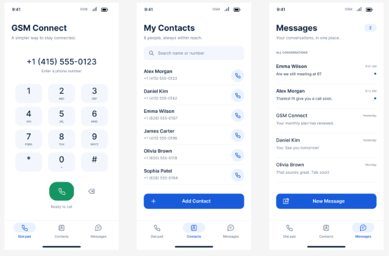

# Experiment 11: GSM Connect Mobile Application Interface Design

## 🎯 Aim & Objective
To design an intuitive, high-fidelity mobile application interface for a cellular communication system ("GSM Connect") incorporating voice call initiation, phonebook contact directory management, and real-time short messaging service (SMS) flows using mobile design principles.

---

## 📱 User Interface Architecture
The design models the core user plane interaction surfaces for mobile cellular subscribers:
1. **Screen 1 — GSM Connect Home & Keypad Dialer:** Direct DTMF dialing interface with active network status indicators, carrier branding, and rapid call execution controls.
2. **Screen 2 — Contacts & Directory:** Alphabetical contact list with caller avatars, contact search indexing, and one-tap voice/message shortcuts.
3. **Screen 3 — Messaging & Conversations:** Consolidated SMS conversation threads displaying sender identities, timestamped message previews, unread indicators, and a compose floating action button (FAB).

---

## 🖼️ Interface Previews & Screens

| Screen | File | Description |
| :--- | :--- | :--- |
| **01** | `01 GSM Connect Home & Dialer.png` | Dialpad keypad, cellular radio connection status, and call buttons. |
| **02** | `02 Contacts & Directory.png` | Contact listing, search bar, and contact card details. |
| **03** | `03 Messaging & Inbox.png` | SMS inbox with chat thread previews and conversation status. |

---

## ⚙️ Design Specifications & Constraints
- **Device Viewport:** iOS / Android Standard (390 × 844 pt)
- **Design System:** Clean minimalist typography, 8pt spacing grid, high-contrast action buttons.
- **Protocol Mapping:** Interacts with GSM Call Control (CC) layer for setup/teardown and Short Message Service (SMS) Point-to-Point (SMS-PP) protocol.
