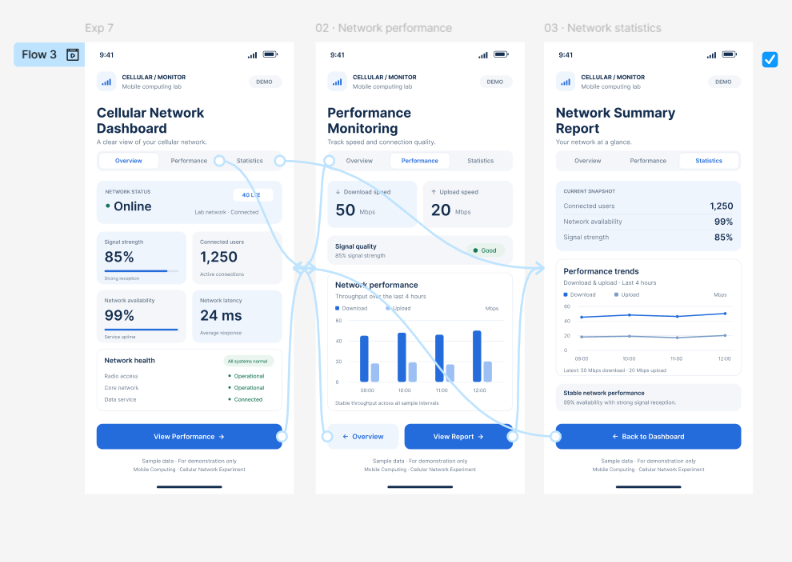

# Experiment 12: Cellular Network Performance & Quality Monitoring Dashboard

## 🎯 Aim & Objective
To architect and visualize a real-time cellular network monitoring dashboard interface capable of tracking key performance indicators (KPIs), signal strength, network latency, active subscriber loads, and downlink/uplink throughput.

---

## 📊 Dashboard Modules & Architecture
1. **Screen 1 — Network Status & Overview:** Visualizes operational network health, active base station connections (1,250 connected users), 99% signal strength, 24 ms average latency, and radio access network (RAN) status.
2. **Screen 2 — Performance Monitoring & Throughput:** Displays live download (50 Mbps) and upload (20 Mbps) rates, signal quality grades (Good/Excellent), and rolling 4-hour historical throughput trends.
3. **Screen 3 — Network Summary & Telemetry Report:** Consolidated executive report summarizing aggregate data consumption, availability metrics, and backhaul health indicators.

---

## 🖼️ Interface Previews & Screens

| Screen | File | Description |
| :--- | :--- | :--- |
| **01** | `01 Network Status & Dashboard.png` | Real-time status cards, connection counts, and latency monitor. |
| **02** | `02 Performance Monitoring & Throughput.png` | Throughput gauges, upload/download bandwidth, and signal stability. |
| **03** | `03 Network Summary & Telemetry Report.png` | Summary analytics, historical trendlines, and diagnostic logs. |

---

## 📡 Radio Telemetry Metrics Tracked
- **RSRP (Reference Signal Received Power):** Cellular coverage quality indicator.
- **RSRQ (Reference Signal Received Quality):** Signal-to-interference radio metric.
- **Round-Trip Time (RTT):** 24 ms end-to-end packet transmission latency.
- **Cell Capacity Utilization:** Tracking active user concentration per sector.
