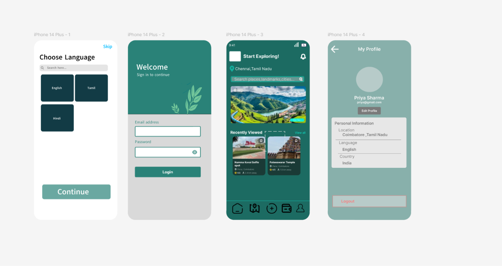

# Experiment 13: Multilingual Location-Based Travel & Profile Application

## 🎯 Aim & Objective
To design an end-to-end user journey for a location-aware mobile application featuring language localization, authentication, geo-location landmark discovery, and user preference profiling.

---

## 🧭 Application Journey & Flows
1. **Screen 1 — Language Selection & Onboarding:** Multilingual localization interface allowing users to select regional dialects (English, Hindi, etc.) before session initiation.
2. **Screen 2 — Authentication & Login:** Secure credential verification flow with email, password, and session persistence options.
3. **Screen 3 — Location Discovery & Exploration:** Real-time Location-Based Service (LBS) interface detecting current GPS coordinates ("Chennai, Tamil Nadu") with contextual search for nearby points of interest.
4. **Screen 4 — User Profile & Preferences:** Account management screen showing personal credentials, home location ("Coimbatore, Tamil Nadu"), language selection, and regional settings.

---

## 🖼️ Interface Previews & Screens

| Screen | File | Description |
| :--- | :--- | :--- |
| **01** | `01 Language Selection & Onboarding.png` | Language selection dropdown and localized greeting. |
| **02** | `02 Authentication & Credentials.png` | Sign-in interface with credential validation and social auth. |
| **03** | `03 Location Discovery & Exploration.png` | Geo-targeted search bar, location pin, and recommended landmarks. |
| **04** | `04 User Profile & Preferences.png` | User profile summary, geo-coordinates, and preferences. |

---

## 📍 Location-Based Services (LBS) Architecture
- **Location Provider:** GPS / Assisted-GPS (A-GPS) and Cell-ID triangulation.
- **Geocoding & Reverse Geocoding:** Translates raw latitude/longitude into human-readable localities.
- **Privacy Controls:** Strict runtime location permission gating (Foreground vs Background).
