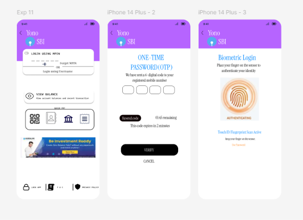

# Experiment 14: Mobile Banking Authentication & Biometric Security Interface

## 🎯 Aim & Objective
To prototype a bank-grade mobile application authentication workflow (inspired by SBI YONO) implementing multi-factor authentication (MFA) across PIN-based access, Out-Of-Band (OOB) OTP verification, and biometric hardware authentication.

---

## 🔐 Multi-Tier Security Architecture
1. **Screen 1 — Secure MPIN Authentication:** Numeric keypad with 6-digit MPIN input, masked character fields, and anti-tamper controls.
2. **Screen 2 — One-Time Password (OTP) Verification:** Timed challenge-response token sent over secure SMS/push notification with a countdown expiration timer (01:45 remaining) and automatic OTP extraction.
3. **Screen 3 — Biometric Fingerprint / Touch ID Scan:** Native Android BiometricPrompt / iOS LocalAuthentication dialog integrating hardware Secure Enclave sensor validation.

---

## 🖼️ Interface Previews & Screens

| Screen | File | Description |
| :--- | :--- | :--- |
| **01** | `01 Secure MPIN Authentication.png` | 6-digit numeric MPIN entry with forgot MPIN recovery. |
| **02** | `02 One-Time Password Verification.png` | SMS OTP 6-digit verification code with timeout and resend. |
| **03** | `03 Biometric Fingerprint Scan.png` | Touch ID / Biometric fingerprint scanner with sensor feedback. |

---

## 🛡️ Mobile Security Best Practices Implemented
- **Hardware-Backed Keystore:** Private keys stored in Android KeyStore / iOS Secure Enclave.
- **Anti-Brute Force Throttling:** Progressive cooldown lockout after 3 invalid MPIN attempts.
- **Certificate Pinning:** TLS sessions strictly pinned against fraudulent MITM proxies.
