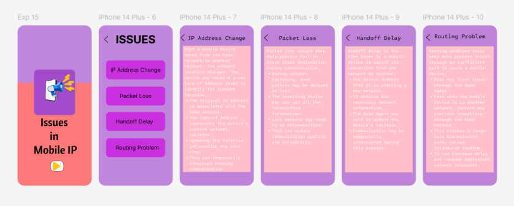

# Experiment 15: Structural Issues & Performance Bottlenecks in Mobile IP

## 🎯 Aim & Objective
To illustrate and dissect the fundamental protocol challenges, latency overheads, and packet delivery issues inherent in Mobile IPv4/v6 architectures through an interactive educational mobile storyboard.

---

## 🌐 Structural Bottlenecks Explored
1. **Screen 1 — Mobile IP Issues Overview:** Master navigation index cataloging the four critical weaknesses of Mobile IP networks.
2. **Screen 2 — IP Address Change & Care-of-Address (CoA):** Dynamics of mobile node relocation across subnet boundaries, Home Address (HoA) binding, and foreign agent Care-of-Address (CoA) registration latency.
3. **Screen 3 — Packet Loss Dynamics:** Packet dropping during link detachment and before binding update propagation to the Home Agent (HA).
4. **Screen 4 — Handoff Latency:** Layer 2 (radio association) plus Layer 3 (router discovery, CoA configuration, registration request/reply round-trip time) delays causing TCP congestion window deflation.
5. **Screen 5 — Triangular Routing & Ingress Filtering:** Data from Correspondent Node (CN) traversing the Home Agent before reaching the Foreign Agent (FA), doubling propagation delay and violating network ingress security filters.

---

## 🖼️ Interface Previews & Screens

| Screen | File | Description |
| :--- | :--- | :--- |
| **01** | `01 Mobile IP Issues Overview.png` | Main category index highlighting the 4 core problems. |
| **02** | `02 IP Address Change & Care-of-Address.png` | HoA vs CoA migration mechanics and binding updates. |
| **03** | `03 Packet Loss Dynamics.png` | Transition in-flight frame drops and recovery mechanisms. |
| **04** | `04 Handoff Latency & Re-registration.png` | Layer 2/3 handoff delay breakdown and registration RTT. |
| **05** | `05 Triangular Routing & Overhead.png` | Triangular routing path vs reverse tunneling solutions. |

---

## 💡 Engineering Solutions & Modern Alternatives
- **Route Optimization Protocol:** Direct CN-to-MN encapsulation bypasses the Home Agent triangle.
- **Fast Handoffs (FMIPv6):** Pre-registration over L2 triggers buffers packets at the new access router.
- **Hierarchical Mobile IP (HMIPv6):** Localizes handoff signaling to Regional Mobility Routers (MAP).
