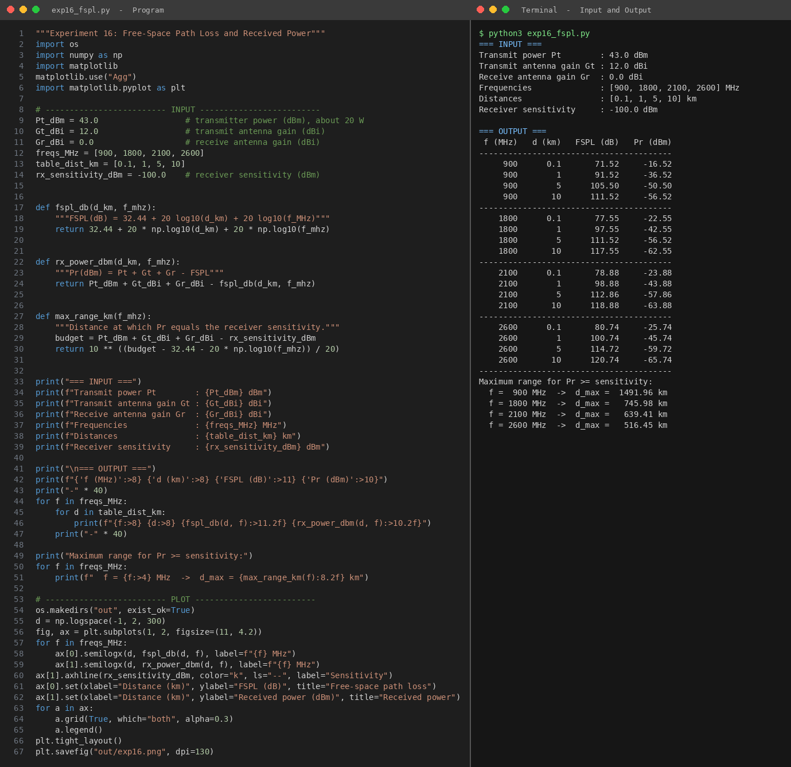

# Experiment 16: Free-Space Path Loss (FSPL) and Received Signal Power

## 🎯 Aim & Objective
To formulate, simulate, and analyze the Free-Space Path Loss (FSPL) and received signal power $P_r$ across various cellular radio frequency bands (900 MHz, 1800 MHz, 2100 MHz, and 2600 MHz) as a function of propagation distance, and to compute the maximum theoretical transmission range under a receiver sensitivity constraint.

---

## 📐 Mathematical Formulation
1. **Free-Space Path Loss (dB):**
   $$\text{FSPL (dB)} = 32.44 + 20\log_{10}(d_{\text{km}}) + 20\log_{10}(f_{\text{MHz}})$$
2. **Link Budget & Received Power ($P_r$):**
   $$P_r (\text{dBm}) = P_t (\text{dBm}) + G_t (\text{dBi}) + G_r (\text{dBi}) - \text{FSPL (dB)}$$
3. **Maximum Radio Range ($d_{\max}$):**
   $$d_{\max} = 10^{\frac{(P_t + G_t + G_r - P_{\text{rx,min}} - 32.44 - 20\log_{10}(f_{\text{MHz}}))}{20}}$$

---

## 💻 Simulation Implementation
- **Source Script:** [`exp16_fspl.py`](exp16_fspl.py)
- **Input Parameters:**
  - Transmitter Power $P_t = 43.0\text{ dBm}$ ($\approx 20\text{ W}$)
  - Transmit Antenna Gain $G_t = 12.0\text{ dBi}$
  - Receive Antenna Gain $G_r = 0.0\text{ dBi}$
  - Receiver Sensitivity $P_{\text{rx,min}} = -100.0\text{ dBm}$
  - Evaluated Distances: $[0.1, 1, 5, 10]\text{ km}$

---

## 📊 Empirical Simulation Results

| Frequency (MHz) | Distance (km) | FSPL (dB) | Received Power $P_r$ (dBm) | Max Range $d_{\max}$ (km) |
| :--- | :--- | :--- | :--- | :--- |
| **900** | 0.1 | 71.52 | -16.52 | **1491.96 km** |
| 900 | 1.0 | 91.52 | -36.52 | |
| 900 | 5.0 | 105.50 | -50.50 | |
| 900 | 10.0 | 111.52 | -56.52 | |
| **1800** | 0.1 | 77.55 | -22.55 | **745.98 km** |
| 1800 | 1.0 | 97.55 | -42.55 | |
| 1800 | 5.0 | 111.52 | -56.52 | |
| 1800 | 10.0 | 117.55 | -62.55 | |
| **2100** | 0.1 | 78.88 | -23.88 | **639.41 km** |
| 2100 | 1.0 | 98.88 | -43.88 | |
| 2100 | 5.0 | 112.86 | -57.86 | |
| 2100 | 10.0 | 118.88 | -63.88 | |
| **2600** | 0.1 | 80.74 | -25.74 | **516.45 km** |
| 2600 | 1.0 | 100.74 | -45.74 | |
| 2600 | 5.0 | 114.72 | -59.72 | |
| 2600 | 10.0 | 120.74 | -65.74 | |

---

## 🖼️ Execution Artifacts

