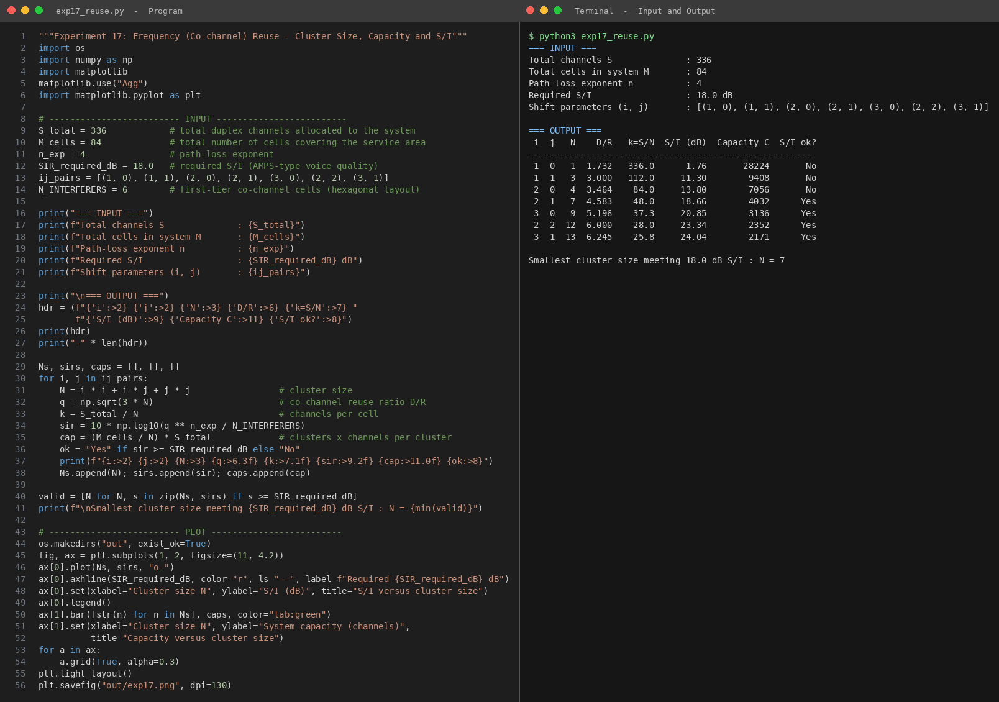

# Experiment 17: Frequency (Co-Channel) Reuse: Cluster Size, Capacity & SIR

## 🎯 Aim & Objective
To model, evaluate, and verify the trade-offs between hexagonal cellular cluster size $N$, co-channel reuse ratio $Q = D/R$, per-cell channel allocation $k = S/N$, worst-case Signal-to-Interference Ratio ($S/I$), and aggregate system capacity $C$ across 84 service cells with 336 duplex channels.

---

## 📐 Mathematical Formulation
1. **Hexagonal Cluster Size:**
   $$N = i^2 + ij + j^2 \quad (i, j \in \mathbb{Z}_{\ge 0})$$
2. **Co-Channel Reuse Distance & Ratio:**
   $$D = R\sqrt{3N} \implies Q = \frac{D}{R} = \sqrt{3N}$$
3. **Worst-Case Omnidirectional Signal-to-Interference Ratio (SIR):**
   $$\frac{S}{I} \approx \frac{R^{-n}}{\sum_{k=1}^{6} D_k^{-n}} = \frac{(\sqrt{3N})^n}{6} \implies \left(\frac{S}{I}\right)_{\text{dB}} = 10\log_{10}\left(\frac{(\sqrt{3N})^n}{6}\right)$$
4. **Total System Capacity:**
   $$C = M \times k = \left(\frac{M}{N}\right) \times S$$

---

## 💻 Simulation Implementation
- **Source Script:** [`exp17_reuse.py`](exp17_reuse.py)
- **Input Parameters:**
  - Total Duplex Channels $S = 336$
  - Total Service Cells $M = 84$
  - Path Loss Exponent $n = 4$
  - Minimum Threshold $(S/I)_{\min} = 18.0\text{ dB}$
  - Candidate Pairs: $(1,0), (1,1), (2,0), (2,1), (3,0), (2,2), (3,1)$

---

## 📊 Empirical Simulation Results

| $i$ | $j$ | Cluster Size $N$ | Reuse Ratio $D/R$ | Channels/Cell $k=S/N$ | $S/I$ (dB) | System Capacity $C$ | $S/I \ge 18\text{ dB}$ |
| :-: | :-: | :-: | :-: | :-: | :-: | :-: | :-: |
| 1 | 0 | 1 | 1.73 | 336 | 1.76 | 28,224 | **NO** |
| 1 | 1 | 3 | 3.00 | 112 | 11.30 | 9,408 | **NO** |
| 2 | 0 | 4 | 3.46 | 84 | 13.80 | 7,056 | **NO** |
| **2** | **1** | **7** | **4.58** | **48** | **18.66** | **4,032** | **YES (Optimal)** |
| 3 | 0 | 9 | 5.20 | 37 | 20.83 | 3,136 | **YES** |
| 2 | 2 | 12 | 6.00 | 28 | 23.34 | 2,352 | **YES** |
| 3 | 1 | 13 | 6.24 | 25 | 24.04 | 2,171 | **YES** |

---

## 🖼️ Execution Artifacts

