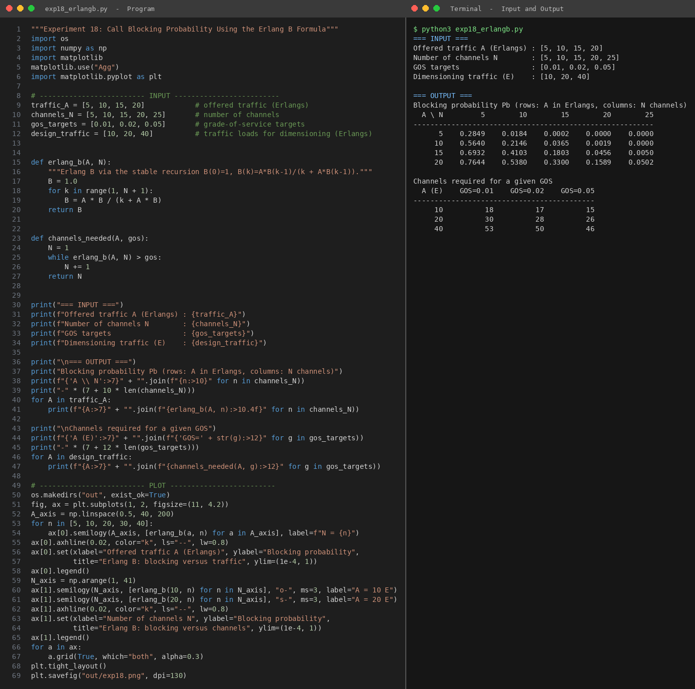

# Experiment 18: Erlang-B Traffic Capacity & Call Blocking Probability

## 🎯 Aim & Objective
To implement the recursive Erlang-B trunking loss model, determine the call blocking probability $P_b$ as a function of offered traffic load $A$ (in Erlangs) and trunked radio channels $N$, and dimension the required channel capacity to satisfy stringent Grade of Service (GOS) targets ($1\%$, $2\%$, and $5\%$).

---

## 📐 Mathematical Formulation
1. **Classical Erlang-B Formula:**
   $$P_b = B(A, N) = \frac{\frac{A^N}{N!}}{\sum_{k=0}^{N} \frac{A^k}{k!}}$$
2. **Numerically Stable Recursive Computation:**
   $$B(A, 0) = 1.0, \quad B(A, k) = \frac{A \cdot B(A, k-1)}{k + A \cdot B(A, k-1)} \quad (k = 1, 2, \dots, N)$$
   *Avoids catastrophic 64-bit floating point overflow ($N! \to \infty$).*

---

## 💻 Simulation Implementation
- **Source Script:** [`exp18_erlangb.py`](exp18_erlangb.py)
- **Evaluated Traffic:** $A \in [5, 10, 15, 20]\text{ Erlangs}$
- **Channel Trunks:** $N \in [5, 10, 15, 20, 25]$
- **Dimensioning Loads:** $A = 10\text{ E}, 20\text{ E}, 40\text{ E}$ across $\text{GOS} \in \{0.01, 0.02, 0.05\}$

---

## 📊 Empirical Simulation Results

### 1. Blocking Probability Matrix ($P_b$)
| Offered Traffic $A$ (Erlangs) | $N = 5$ Channels | $N = 10$ Channels | $N = 15$ Channels | $N = 20$ Channels | $N = 25$ Channels |
| :-: | :-: | :-: | :-: | :-: | :-: |
| **5 E** | 0.2849 | 0.0184 | 0.0002 | 0.0000 | 0.0000 |
| **10 E** | 0.5640 | 0.2146 | 0.0365 | 0.0019 | 0.0000 |
| **15 E** | 0.6932 | 0.4103 | 0.1803 | 0.0456 | 0.0050 |
| **20 E** | 0.7644 | 0.5380 | 0.3300 | 0.1589 | 0.0502 |

### 2. Dimensioning Requirements (Channels $N$ for target GOS)
| Offered Traffic $A$ | $\text{GOS} = 0.01$ ($1\%$) | $\text{GOS} = 0.02$ ($2\%$) | $\text{GOS} = 0.05$ ($5\%$) |
| :-: | :-: | :-: | :-: |
| **10 Erlangs** | **18 Channels** | **17 Channels** | **15 Channels** |
| **20 Erlangs** | **30 Channels** | **28 Channels** | **26 Channels** |
| **40 Erlangs** | **53 Channels** | **50 Channels** | **46 Channels** |

---

## 🖼️ Execution Artifacts

