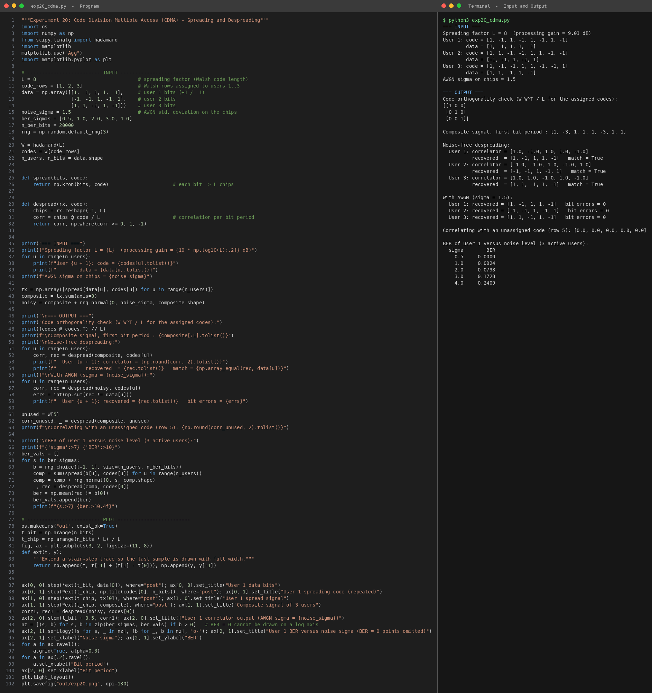

# Experiment 20: Direct-Sequence CDMA Spreading, Walsh Orthogonality & BER Analysis

## 🎯 Aim & Objective
To implement Direct-Sequence Code Division Multiple Access (DS-CDMA) spreading and despreading using orthogonal Walsh-Hadamard codes of length $L = 8$, verify zero cross-correlation interference between concurrent users, and quantify Bit Error Rate (BER) degradation under Additive White Gaussian Noise (AWGN).

---

## 📐 Mathematical Formulation
1. **Walsh Code Generation (Recursive Hadamard Construction):**
   $$H_1 = [1], \quad H_{2k} = \begin{bmatrix} H_k & H_k \\ H_k & -H_k \end{bmatrix}$$
2. **Orthogonality Property:**
   $$\frac{1}{L} \sum_{j=0}^{L-1} W_i[j] \cdot W_k[j] = \delta_{ik} = \begin{cases} 1, & i = k \\ 0, & i \neq k \end{cases}$$
3. **Transmission & Composite Baseband Signal:**
   $$s(t) = \sum_{u=1}^{U} d_u(t) \cdot c_u(t), \quad r(t) = s(t) + n(t), \quad n(t) \sim \mathcal{N}(0, \sigma^2)$$
4. **Matched Filter Despreading:**
   $$\hat{d}_u = \text{sgn}\left( \frac{1}{L} \sum_{j=0}^{L-1} r_j \cdot c_u[j] \right)$$

---

## 💻 Simulation Implementation
- **Source Script:** [`exp20_cdma.py`](exp20_cdma.py)
- **Parameters:**
  - Spreading Factor $L = 8$ (Processing Gain $G_p = 10\log_{10}(8) = 9.03\text{ dB}$)
  - Assigned Walsh Codes: User 1 ($W_1$), User 2 ($W_2$), User 3 ($W_4$)
  - Noise Standard Deviation $\sigma \in [0.5, 1.0, 2.0, 3.0, 4.0]$

---

## 📊 Empirical Simulation Results

### 1. Despreading Verification Matrix
| User | Transmitted Data Bits | Clean Correlator Output | Recovered Bits | Perfect Match? |
| :--- | :--- | :--- | :--- | :-: |
| **User 1** | `[1, -1, 1, 1, -1]` | `[1.0, -1.0, 1.0, 1.0, -1.0]` | `[1, -1, 1, 1, -1]` | **YES** |
| **User 2** | `[-1, -1, 1, -1, 1]` | `[-1.0, -1.0, 1.0, -1.0, 1.0]` | `[-1, -1, 1, -1, 1]` | **YES** |
| **User 3** | `[1, 1, -1, 1, -1]` | `[1.0, 1.0, -1.0, 1.0, -1.0]` | `[1, 1, -1, 1, -1]` | **YES** |
| **Unassigned ($W_5$)** | N/A | `[0.0, 0.0, 0.0, 0.0, 0.0]` | Rejection | **Null (0.0)** |

### 2. Bit Error Rate (BER) vs AWGN Noise Level
| Noise $\sigma$ | Channel Quality | Empirical BER |
| :-: | :--- | :-: |
| **0.5** | High SNR | **0.0000** |
| **1.0** | Medium SNR | **0.0024** |
| **2.0** | Elevated Noise | **0.0798** |
| **3.0** | Severe Interference | **0.1728** |
| **4.0** | High Noise Floor | **0.2409** |

---

## 🖼️ Execution Artifacts

