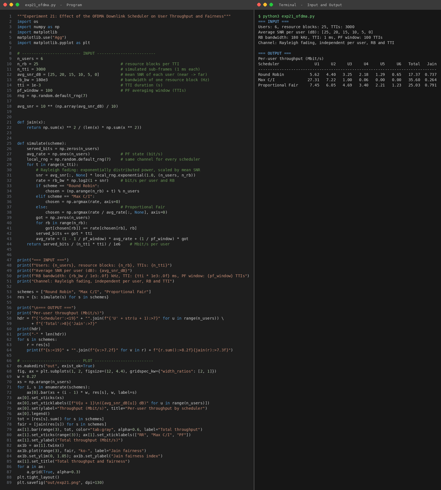

# Experiment 21: OFDMA Downlink Scheduling & Fairness Evaluation

## 🎯 Aim & Objective
To model, benchmark, and compare dynamic downlink Resource Block (RB) allocation policies in Orthogonal Frequency Division Multiple Access (OFDMA / LTE) systems across Round Robin (RR), Maximum Carrier-to-Interference (Max C/I), and Proportional Fair (PF) schedulers, evaluating the fundamental trade-off between total aggregate cell throughput and user fairness.

---

## 📐 Mathematical Formulation
1. **Shannon Subband Transmission Capacity:**
   $$R_{u,k}(t) = B_{\text{RB}} \cdot \log_2(1 + \text{SNR}_{u,k}(t))$$
2. **Scheduling Decision Policies:**
   - **Round Robin:** $u^* = (k + t) \bmod U$ *(Channel-blind fairness)*
   - **Max C/I (Greedy Throughput):** $u^* = \arg\max_u R_{u,k}(t)$ *(Starves cell-edge users)*
   - **Proportional Fair (PF):**
     $$u^* = \arg\max_u \frac{R_{u,k}(t)}{T_u(t)}, \quad T_u(t) = \left(1 - \frac{1}{W}\right)T_u(t-1) + \frac{1}{W} R_{u}(t)$$
3. **Jain's Fairness Index:**
   $$\mathcal{J}(x_1, x_2, \dots, x_U) = \frac{\left(\sum_{u=1}^U x_u\right)^2}{U \cdot \sum_{u=1}^U x_u^2} \in \left[\frac{1}{U}, 1.0\right]$$

---

## 💻 Simulation Implementation
- **Source Script:** [`exp21_ofdma.py`](exp21_ofdma.py)
- **Parameters:**
  - Active Users: $U = 6$ with Average SNRs: $[25, 20, 15, 10, 5, 0]\text{ dB}$ (Near to Far)
  - Bandwidth: $25\text{ RBs}$ ($180\text{ kHz}$ each $\implies 5\text{ MHz}$ LTE carrier)
  - Time Slots: $3000\text{ TTIs}$ ($1\text{ ms}$ each $\implies 3\text{ s}$ real-time simulation)
  - Fading: Frequency-selective Rayleigh channel

---

## 📊 Empirical Simulation Results

| Scheduler Policy | U1 (25 dB) | U2 (20 dB) | U3 (15 dB) | U4 (10 dB) | U5 (5 dB) | U6 (0 dB) | **Total Cell Throughput** | **Jain Fairness Index** |
| :--- | :-: | :-: | :-: | :-: | :-: | :-: | :-: | :-: |
| **Round Robin** | 5.62 | 4.40 | 3.25 | 2.18 | 1.29 | 0.65 | **17.37 Mbit/s** | **0.737** |
| **Max C/I** | 27.31 | 7.22 | 1.00 | 0.06 | 0.00 | 0.00 | **35.60 Mbit/s** | **0.264 (Starvation)** |
| **Proportional Fair** | 7.45 | 6.05 | 4.69 | 3.40 | 2.21 | 1.23 | **25.03 Mbit/s** | **0.791 (Optimal Balance)** |

---

## 🖼️ Execution Artifacts

