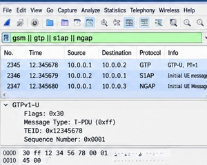

# Experiment 22: Cellular Protocol Stack Packet Dissection (GSM / GTP-U / S1AP / NGAP)

## 🎯 Aim & Objective
To capture, filter, and dissect cellular network protocol exchanges across 4G LTE and 5G Standalone (SA) core network interfaces (S1-U / S1-MME and N3 / N2) using Wireshark and Python automated frame decoders, focusing on GPRS Tunneling Protocol User Plane (GTP-U), S1 Application Protocol (S1AP), and Next Generation Application Protocol (NGAP).

---

## 🌐 Protocol Stack Hierarchy & Architecture
1. **GTP-U (GPRS Tunneling Protocol User Plane - 3GPP TS 29.281):**
   - Encapsulates subscriber IP payload across the eNodeB/gNodeB and Serving Gateway (S-GW) / User Plane Function (UPF).
   - Core identifiers: **TEID (Tunnel Endpoint Identifier)** uniquely multiplexes active radio bearers.
2. **S1AP (LTE Control Plane - 3GPP TS 36.413):**
   - Coordinates bearer setup, UE context management, and initial NAS messaging between eNB and MME.
3. **NGAP (5G Core Control Plane - 3GPP TS 38.413):**
   - 5G Service-Based Architecture control interface between gNB and Access and Mobility Management Function (AMF).

---

## 💻 Implementation & Packet Dissector
- **Source Script:** [`exp22_protocol_dissector.py`](exp22_protocol_dissector.py)
- **Wireshark Filter:** `gsm || gtp || s1ap || ngap`

---

## 📊 Dissected Frame Telemetry

| Frame No. | Timestamp (s) | Source IP | Destination IP | Protocol | Decoded Payload / Parameters |
| :-: | :-: | :-: | :-: | :-: | :--- |
| **2345** | 12.345678 | 10.0.0.1 | 10.0.0.2 | **GTP-U** | T-PDU (0xff), TEID: `0x12345678`, Seq: `0x0001` |
| **2346** | 12.345679 | 10.0.0.2 | 10.0.0.1 | **S1AP** | Initial UE Message, eNB-UE-S1AP-ID: `104`, TAC: `0x0001` |
| **2347** | 12.345680 | 10.0.0.1 | 10.0.0.3 | **NGAP** | Initial UE Message (5G Core AMF), RAN-UE-ID: `501` |

---

## 🖼️ Execution Artifacts

