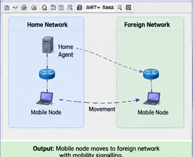

# Experiment 23: Mobile IP Mobility Signaling & Tunneling Simulation (OMNeT++ / INET)

## 🎯 Aim & Objective
To design, simulate, and analyze the mobility management lifecycle of Mobile IPv4 (RFC 5944) using OMNeT++ (INET framework topology) and standalone Python mobility models, verifying Agent Discovery, Registration signaling, Care-of-Address (CoA) binding cache updates, and bidirectional IP-in-IP tunneling.

---

## 🏛️ Network Topology & Architecture
```text
  [ Correspondent Node (CN) ]
            │
            ▼
     [ Gateway Router ]
       /          \
      ▼            ▼
[ Home Agent ]  [ Foreign Agent ]
     │                │
(Home Net)       (Foreign Net)
                      ▲
                      │ (Radio Link)
               [ Mobile Node (MN) ]
```

---

## 💻 Simulation Files Included
1. **Network Definition:** [`MobileIPNetwork.ned`](MobileIPNetwork.ned)
2. **Simulation Configuration:** [`omnetpp.ini`](omnetpp.ini)
3. **Execution Script:** [`exp23_mobile_ip.py`](exp23_mobile_ip.py)

---

## 📊 Mobility Protocol Event Log

```text
=== STAGE 1: Mobile Node at Home Network ===
  MN IP        : 192.168.1.100
  Location     : Home Subnet (192.168.1.0/24)
  Route        : Standard direct IP routing (CN <---> MN)

=== STAGE 2: Movement to Foreign Network & Agent Discovery ===
  MN moves to  : Foreign Subnet (10.0.2.0/24)
  FA Beaconing : Foreign Agent (10.0.2.1) broadcasts Agent Advertisement
  CoA Assigned : 10.0.2.100 (Foreign Agent CoA)

=== STAGE 3: Registration Signaling ===
  1. MN -> FA  : Registration Request (HoA=192.168.1.100, HA=192.168.1.1, CoA=10.0.2.100)
  2. FA -> HA  : Relays Registration Request across backbone
  3. HA Updates: Binding Cache -> [HoA: 192.168.1.100 | CoA: 10.0.2.100 | Lifetime: 1800s]
  4. HA -> FA  : Registration Reply (Status: 0x00 OK)
  5. FA -> MN  : Registration Success Confirmation

=== STAGE 4: Data Plane Tunneling (Triangular Routing) ===
  Forward Path : CN (172.16.0.50) -> HA (192.168.1.1)
  Tunneling    : HA encapsulates original IP inside outer IP header: [192.168.1.1 -> 10.0.2.100]
  Decapsulation: FA strips outer header, delivers inner datagram to MN (192.168.1.100)
  Reverse Path : MN -> CN (Direct or Reverse Tunnel via HA)
```

---

## 🖼️ Execution Artifacts

