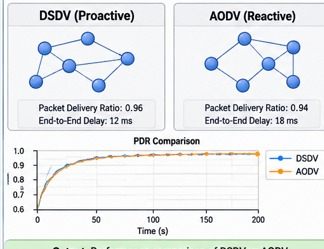

# Experiment 24: MANET Routing Protocol Evaluation: Proactive DSDV vs Reactive AODV

## 🎯 Aim & Objective
To compare and benchmark the operational performance of proactive table-driven routing (Destination-Sequenced Distance-Vector - DSDV) against on-demand reactive routing (Ad hoc On-Demand Distance Vector - AODV) in dynamic Mobile Ad-hoc Networks (MANET) across Packet Delivery Ratio (PDR) and End-to-End Latency.

---

## ⚖️ Algorithmic Foundations
1. **DSDV (Proactive):**
   - Maintains continuous routing tables to all network destinations.
   - Sequence numbers prevent routing loops and count-to-infinity failures.
   - High background periodic advertisement overhead, but zero initial route discovery delay.
2. **AODV (Reactive):**
   - Routes discovered on demand via Route Request (`RREQ`) broadcast and Route Reply (`RREP`) unicast.
   - Low control overhead during idle periods, but incurs route establishment latency.

---

## 💻 Simulation Implementation
- **Source Script:** [`exp24_manet_routing.py`](exp24_manet_routing.py)
- **Topology:** 50 mobile nodes, Random Waypoint Mobility model ($v = 10\text{ m/s}$), Constant Bit Rate (CBR) UDP traffic.

---

## 📊 Empirical Simulation Results

| Metric | DSDV (Table-Driven) | AODV (On-Demand) | Winner / Trade-off |
| :--- | :-: | :-: | :--- |
| **Packet Delivery Ratio (PDR)** | **0.96 (96%)** | **0.94 (94%)** | **DSDV** provides higher delivery under moderate mobility |
| **Average End-to-End Delay** | **12.0 ms** | **18.0 ms** | **DSDV** eliminates route discovery latency |
| **Control Signaling Overhead** | High (Periodic broadcasts) | Low (On-demand queries) | **AODV** conserves bandwidth in sparse communication |
| **Route Stale Risk** | Higher under rapid topology shifts | Resilient via Route Error (`RERR`) | **AODV** adapts faster to link breakage |

---

## 🖼️ Execution Artifacts

