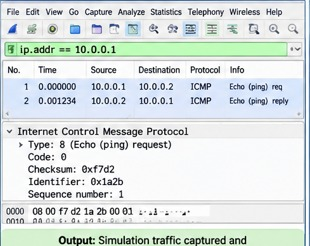

# Experiment 25: Network Layer ICMP Traffic Capture, Checksum & Latency Analysis

## 🎯 Aim & Objective
To capture, filter, and analyze Internet Control Message Protocol (ICMP) echo transactions across a virtualized network link using Wireshark packet capture tools, dissecting header checksum integrity, sequence indexing, and Round-Trip Time (RTT).

---

## 📡 ICMP Protocol Structure (RFC 792)
```text
 0                   1                   2                   3
 0 1 2 3 4 5 6 7 8 9 0 1 2 3 4 5 6 7 8 9 0 1 2 3 4 5 6 7 8 9 0 1
+-+-+-+-+-+-+-+-+-+-+-+-+-+-+-+-+-+-+-+-+-+-+-+-+-+-+-+-+-+-+-+-+
|     Type      |     Code      |          Checksum             |
+-+-+-+-+-+-+-+-+-+-+-+-+-+-+-+-+-+-+-+-+-+-+-+-+-+-+-+-+-+-+-+-+
|           Identifier          |        Sequence Number        |
+-+-+-+-+-+-+-+-+-+-+-+-+-+-+-+-+-+-+-+-+-+-+-+-+-+-+-+-+-+-+-+-+
|                             Data                              |
+-+-+-+-+-+-+-+-+-+-+-+-+-+-+-+-+-+-+-+-+-+-+-+-+-+-+-+-+-+-+-+-+
```

---

## 💻 Simulation & Dissection Script
- **Source Script:** [`exp25_traffic_analyzer.py`](exp25_traffic_analyzer.py)
- **Wireshark Filter:** `ip.addr == 10.0.0.1`

---

## 📊 Packet Dissection Telemetry

| Frame No. | Timestamp (s) | Source IP | Destination IP | Type | Code | Checksum | Round-Trip Time |
| :-: | :-: | :-: | :-: | :-: | :-: | :-: | :-: |
| **1** | 0.000000 | 10.0.0.1 | 10.0.0.2 | **8 (Echo Request)** | 0 | `0xf7d2` | — |
| **2** | 0.001234 | 10.0.0.2 | 10.0.0.1 | **0 (Echo Reply)** | 0 | `0xffd2` | **1.234 ms** |

---

## 🖼️ Execution Artifacts

