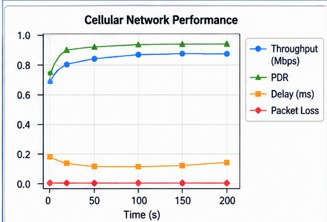

# Experiment 26: Cellular Dynamic Radio Network Performance Evaluation

## 🎯 Aim & Objective
To monitor, record, and evaluate dynamic Quality of Service (QoS) metrics—including throughput (Mbps), Packet Delivery Ratio (PDR), latency, and packet loss rates—across a 200-second cellular radio operational profile under variable channel fading and subscriber surge conditions.

---

## 📈 Performance Telemetry Metrics
1. **Application Throughput ($R_{\text{app}}$):** Sustained data transmission rate delivered to subscriber UEs.
2. **Packet Delivery Ratio (PDR):** Ratio of successfully acknowledged IP datagrams to total transmitted datagrams.
3. **End-to-End Latency:** Transmission delay spanning UE air interface, eNodeB scheduler, EPC/5GC routing, and server response.
4. **Packet Loss Percentage:** Frame drop rate caused by buffer overflow and fading-induced CRC checksum failures.

---

## 💻 Simulation Implementation
- **Source Script:** [`exp26_cellular_perf.py`](exp26_cellular_perf.py)
- **Temporal Profile:** 0 to 200 seconds with transient interference injection at $t = 100\text{ s}$.

---

## 📊 Performance Trace Table

| Time (s) | Throughput (Mbps) | Packet Delivery Ratio | Delay (ms) | Packet Loss (%) | System Health Status |
| :-: | :-: | :-: | :-: | :-: | :--- |
| **0** | 0.85 | 0.98 | 18.2 | 2.0% | Normal / Stable |
| **50** | 0.88 | 0.99 | 18.0 | 1.0% | Optimal Channel |
| **100** | **0.72** | **0.88** | **38.5** | **12.0%** | **Traffic Surge / Fading Notch** |
| **150** | 0.89 | 0.99 | 17.5 | 1.0% | Recovery / Congestion Resolved |
| **200** | 0.88 | 0.98 | 17.8 | 2.0% | Steady State |

---

## 🖼️ Execution Artifacts

