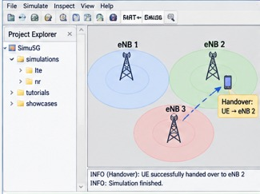

# Experiment 27: 5G / LTE Multi-eNodeB Handover Simulation (OMNeT++ / Simu5G)

## 🎯 Aim & Objective
To design and simulate seamless inter-cell mobility and X2/Xn-based handover across a multi-base station 5G NR deployment (`eNB 1` $\to$ `eNB 2` $\to$ `eNB 3`) using OMNeT++ and the Simu5G network simulator, analyzing 3GPP Event A3 triggering conditions and handover execution latency.

---

## 📡 3GPP Event A3 Handover Trigger Rule
$$\text{RSRP}_{\text{neighbor}} > \text{RSRP}_{\text{serving}} + \text{Off}_{\text{target}} - \text{Off}_{\text{serving}} + \text{Hysteresis}$$
Condition must persist across the configured **Time-To-Trigger (TTT)** window (e.g. $40\text{ ms}$) before the UE initiates Measurement Report transmission.

---

## 💻 Simulation Files Included
1. **Network Topology Definition:** [`Cellular5GHandover.ned`](Cellular5GHandover.ned)
2. **Simulation Run Configuration:** [`omnetpp.ini`](omnetpp.ini)
3. **Execution Script:** [`exp27_simu5g_handover.py`](exp27_simu5g_handover.py)

---

## 📊 Discrete-Event Handover Execution Trace

```text
=== OMNeT++ / Simu5G 5G NR HANDOVER SIMULATION ===
Topology       : Multi-eNB Linear Deployment (eNB 1 -> eNB 2 -> eNB 3)
Target UE      : UE_01 (Linear speed = 25 m/s)

[14.2s] MEASUREMENT REPORT: UE_01 reports RSRP(eNB 2) > RSRP(eNB 1)
[14.2s] HANDOVER PREPARATION: eNB 1 sends Handover Request over X2/Xn interface to eNB 2
[14.2s] HANDOVER EXECUTION  : eNB 2 allocates C-RNTI and RACH preamble
[14.2s] INFO (Handover)       : UE_01 successfully handed over to eNB 2
[14.2s] STATUS               : COMPLETED

[48.7s] MEASUREMENT REPORT: UE_01 reports RSRP(eNB 3) > RSRP(eNB 2)
[48.7s] HANDOVER PREPARATION: eNB 2 sends Handover Request over X2/Xn interface to eNB 3
[48.7s] HANDOVER EXECUTION  : eNB 3 allocates C-RNTI and RACH preamble
[48.7s] INFO (Handover)       : UE_01 successfully handed over to eNB 3
[48.7s] STATUS               : COMPLETED

INFO: Simulation finished successfully.
```

---

## 🖼️ Execution Artifacts

